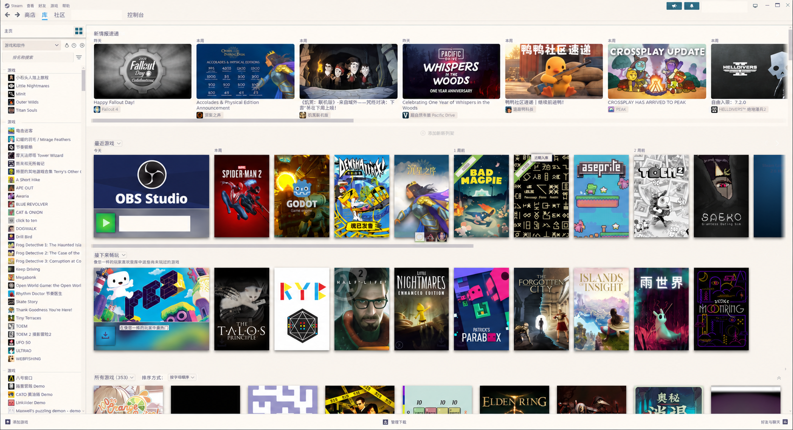
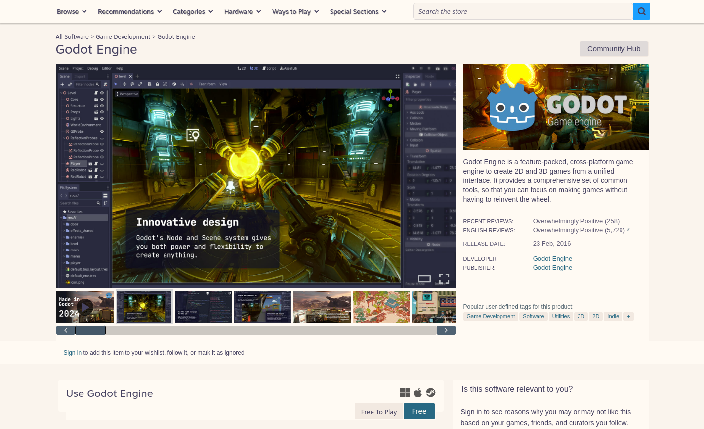

# Rosé Pine Dawn for Millennium

A light theme for the Steam desktop client, built with the [Rosé Pine Dawn palette](https://rosepinetheme.com/palette/). It uses warm cream surfaces, purple-gray text, and pine-blue accents across the library and store.

This theme is loaded by [Millennium](https://steambrew.app/). It has one light appearance and includes compiled CSS, so installation requires no additional plugin or build step.

## Preview



Library home example from an earlier screenshot, with AI-assisted privacy edits. Account names, the account avatar, custom category names, and playtime statistics are obscured. Game artwork and the library list remain visible.



Public store page shown while signed out, with no Steam account or personal library information.

## Install

Install Millennium before installing this theme. The theme package contains `skin.json` and the CSS files that Millennium loads; see the [Millennium theme structure documentation](https://docs.steambrew.app/themes/basics/structure).

### Linux

Clone the repository and run the installer from the checkout:

```bash
git clone https://github.com/AkaCMD/rose-pine-dawn-millennium.git
cd rose-pine-dawn-millennium
bash install.sh
```

The [installer](install.sh) checks `~/.steam/steam` and `~/.local/share/Steam`. For a different Steam location, pass its root directory:

```bash
bash install.sh /path/to/Steam
```

The script installs the theme into `<Steam>/millennium/themes/rose-pine-dawn/`, replacing the existing directory on updates. After installation succeeds, it deletes old `rose-pine-dawn.backup-*` copies so Millennium lists only one copy of this theme. Other themes are left untouched.

### Manual installation

Download this repository using **Code → Download ZIP** and extract it. Copy the extracted folder into your Steam installation's `millennium/themes/` directory, then rename the folder to `rose-pine-dawn`.

Check that these paths exist before enabling the theme:

```text
<Steam>/millennium/themes/rose-pine-dawn/
├── skin.json
└── css/
    ├── light.css
    ├── steam.css
    ├── store.css
    ├── library-game.css
    ├── downloads.css
    └── store-lists.css
```

### Windows

1. Install Millennium using the Windows installer linked in the [official installation guide](https://docs.steambrew.app/users/getting-started/installation). Follow the installer prompts to complete setup.
2. Exit Steam completely using **Steam → Exit** before copying the theme files.
3. Download this repository using **Code → Download ZIP**, then choose **Extract All** in File Explorer.
4. Open your Steam installation folder, the folder containing `steam.exe`. For example, if Steam is installed at `C:\Program Files (x86)\Steam`, open `C:\Program Files (x86)\Steam\millennium\themes`. Create the `themes` folder if it does not exist. Use your actual Steam installation path if it differs from the example. The [official directory reference](https://docs.steambrew.app/users/getting-started/structure) documents this location.
5. Copy the extracted repository folder into `themes` and rename it to `rose-pine-dawn`. Ensure `skin.json` is directly inside `rose-pine-dawn`, with the `css` folder beside it, as shown in [Manual installation](#manual-installation). Avoid an extra nested repository folder.
6. Start Steam and follow [Enable and use](#enable-and-use) to select the theme and restart Steam.

Windows uses the manual installation method; `install.sh` is the Linux installer. To update on Windows, exit Steam, replace the `rose-pine-dawn` folder with the newly extracted copy, and start Steam again. If the theme is missing from the list, check the folder name and the location of `skin.json`.

## Enable and use

Open Millennium's theme settings in Steam and select **Rosé Pine Dawn**. Restart Steam to load the theme across its windows.

The theme follows normal Steam navigation. Game covers, promotional artwork, and text embedded in images retain their original appearance.

To update a Linux installation, pull the repository changes, rerun the installer, and restart Steam:

```bash
git pull --ff-only
bash install.sh
```

For manual installations, replace the theme folder with the extracted updated copy, then restart Steam.

## Coverage and compatibility

The [theme manifest](skin.json) loads styles for the client frame, library home, collection grids, game details, settings, menus, and store pages. The sidebar styles include the collection shortcut, game-type dropdown, and sorting button.

Local checks on October 24, 2026 used CachyOS, Millennium 3.6.1, and Steam build 1792618285. Checked views included collection grids, Godot and TOEM library details, the settings language dropdown, and store product, search, and browse views.

Windows and macOS have not been tested. Big Picture, the in-game overlay, and all friends/chat states have not been checked individually. Contrast checks covered visible text with computable backgrounds; they do not establish accessibility compliance across Steam.

Steam updates can change the internal CSS classes used by this theme. When reporting a dark panel or unreadable label, include the page name, a screenshot, and your Steam and Millennium versions.

## Theme development

Edit the Sass sources in [`scss/`](scss/), then commit both the sources and the generated files in `css/`. Millennium loads the compiled CSS paths listed in [`skin.json`](skin.json).

Use Node.js 22 or newer to install the development dependencies and compile the theme:

```bash
npm ci
npm run build
```

Run `npm run watch` to compile changes as you edit. Run `npm run build:check` to check that the committed CSS matches the Sass sources without writing files.

The six `.scss` entry points match the six CSS files in the manifest. The `steam/` and `store/` directories group rules by interface area; their entry points preserve module order because later rules override earlier ones. The shared palette lives in [`scss/shared/_tokens.scss`](scss/shared/_tokens.scss), with consistency checks against `palette.json`. The shared `surface` mixin emits background and foreground declarations in place, preserving selectors and specificity. Keep the runtime `--rp-*` custom properties when adding rules.

## Coverage tests

After installing the development dependencies, run `npm test` for local checks, including verification that the generated CSS matches its Sass sources. With Steam's local CEF debugging endpoint available, run `npm run test:coverage` to generate a report of suspected theme gaps and unverified regions. See the [coverage testing guide](docs/theme-coverage.md) for state captures, strict mode, browser verification, and limitations, and the [coverage glossary](CONTEXT.md) for terminology.

## Restore the default appearance

Select the default theme in Millennium and restart Steam. You can then remove `<Steam>/millennium/themes/rose-pine-dawn/`.

## Credits

The color reference is [Rosé Pine](https://rosepinetheme.com/), with palette data from [rose-pine/palette](https://github.com/rose-pine/palette). Its MIT license is included in [licenses/rose-pine-MIT.txt](licenses/rose-pine-MIT.txt).

This is an independent theme maintained by AkaCMD. It is not affiliated with Valve, Millennium, or the Rosé Pine project.
